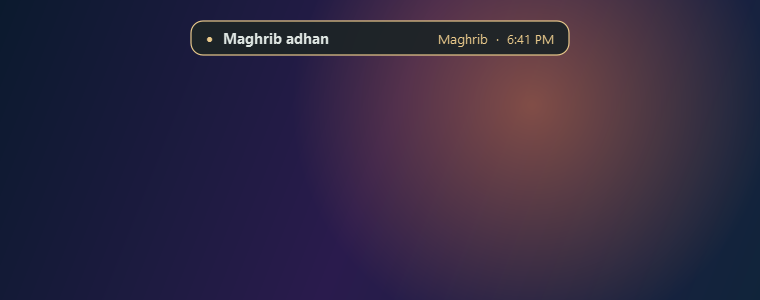
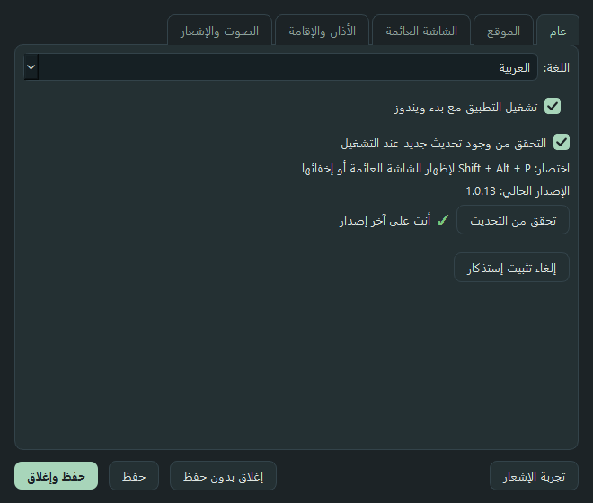
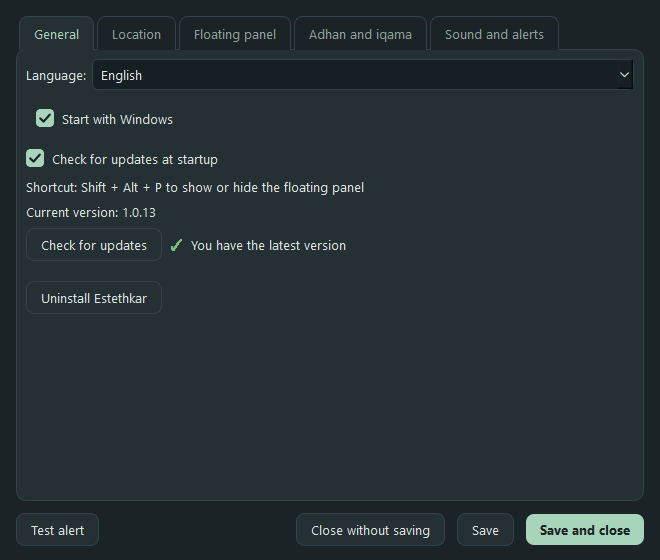

# إستذكار

**شاشة عائمة صغيرة تعدّ الوقت للصلاة القادمة وتنبّهك عند الأذان والإقامة، حتى وأنت داخل اللعبة.**

[English](README.md) | **العربية**

 

## التحميل

**[تحميل المثبّت: Estethkar-Setup.exe](https://github.com/NuClear-Mind/Estethkar/releases/latest/download/Estethkar-Setup.exe)**

- ملف واحد. يسألك عن المجلد، ويضيف اختصارًا على سطح المكتب، ويشغّل البرنامج.
- بدون تثبيت؟ حمّل `Estethkar.exe` من [صفحة الإصدارات](https://github.com/NuClear-Mind/Estethkar/releases/latest) وشغّله مباشرة.
- يحتاج Windows 10 أو 11.

## المميزات

- **عدّاد فوق الألعاب.** كبسولة أفقية أو عمودية أو لوحة كاملة، بحجم من 50٪ إلى 250٪، وتحرّكها بالماوس. الاختصار `Shift + Alt + P` يُظهرها ويُخفيها.
- **الإقامة واضحة.** عدّاد الإقامة بلون ذهبي ومكتوب عليه «الإقامة»، فما يلتبس عليك مع الأذان.
- **تنبيه بدون إزعاج.** النقطة تومض قبل الأذان بـ 3 ثوانٍ وقبل الإقامة بـ 5 ثوانٍ، بدون صوت.
- **إشعار وصوت دائمًا.** شريط من أعلى الشاشة أو بطاقة في الزاوية، مع أربعة أصوات جاهزة أو ملف WAV خاص. يعملان حتى لو كانت لعبة شغّالة.
- **مواقيت دقيقة بدون إنترنت.** تُحسب على جهازك حسب مدينتك بطريقة أم القرى، وتقدر تضبط كل صلاة بالثواني لتطابق مسجدك.
- **عربي وإنجليزي،** والمدن قابلة للبحث بالعربي والإنجليزي.
- **يعمل مع بدء ويندوز،** ويتحدّث من داخل البرنامج بضغطة زر، ويُحذف بالكامل من الإعدادات.

  

   

## الألعاب

- الشاشة والإشعار يظهران فوق الألعاب في وضع **Borderless** أو **Windowed Fullscreen**.
- وضع **Exclusive Fullscreen** الحقيقي يخفي أي نافذة فوقه، وهذا من ويندوز نفسه: الصوت يعمل لكن الشاشة ما تظهر. غيّر وضع اللعبة إلى Borderless.
- البرنامج **لا يتدخل في اللعبة**: لا حقن ولا قراءة ذاكرة ولا هوكات. يستخدم نافذة عادية وطلبات ويندوز القياسية فقط. مع ذلك لا أضمن كيف يتعامل كل نظام مكافحة غش مع أي نافذة عائمة، فجرّبه بحذر في الألعاب التنافسية الحساسة.

## الخصوصية

- لا حساب، ولا تتبّع، ولا إعلانات، ولا تُرسل أي بيانات عنك.
- الإعدادات تُحفظ في ملف `config.json` جنب البرنامج على جهازك فقط.
- الاتصالات بالإنترنت محدودة بشيئين:
  1. التحقق من التحديث من GitHub (يمكن إيقافه من الإعدادات).
  2. تحديد المدينة من عنوان الـ IP عبر `ipapi.co`، فقط إذا اخترت «تلقائي». الافتراضي أن تختار مدينتك بنفسك.

## تحذير ويندوز

البرنامج جديد وغير موقّع رقميًا، فقد يعرض ويندوز تحذير **SmartScreen**، أو يعلّمه مضاد الفيروسات بالخطأ. هذا يحصل مع البرامج الصغيرة غير الموقّعة.

- اضغط **More info** ثم **Run anyway**.
- تقدر تتأكد أن الملف سليم. بصمة **SHA-256** لكل ملف مكتوبة في ملاحظات الإصدار. في PowerShell: `Get-FileHash .\Estethkar-Setup.exe`

## عن المواقيت

- الطريقة: **أم القرى** (الفجر 18.5°، والعشاء بعد المغرب بـ 90 دقيقة، و120 في رمضان). قورنت النتائج مع خدمة Aladhan.
- المواقيت تعتمد على ساعة ويندوز ومنطقتها الزمنية، فخلّ مزامنة الوقت مفعّلة.
- الجدول الرسمي لمسجدك أو مدينتك هو المرجع. استخدم ضبط الثواني في الإعدادات إن اختلف.

## الحذف

الإعدادات ← عام ← **إلغاء تثبيت إستذكار**، أو من إعدادات ويندوز ← التطبيقات. يحذف البرنامج وملفاته والاختصار وتشغيله مع ويندوز.

## مشكلة أو اقتراح

افتح [Issue](https://github.com/NuClear-Mind/Estethkar/issues/new/choose) واكتب رقم الإصدار واسم اللعبة ووضع الشاشة فيها.

سجل التغييرات: [CHANGELOG.ar.md](CHANGELOG.ar.md)

## الرخصة والشكر

MIT. حقوق النشر (c) 2026 Turky ALrowaily. التفاصيل في [LICENSE](LICENSE).

بيانات المدن من [GeoNames](https://www.geonames.org/) (المدن التي عدد سكانها 15,000 أو أكثر)، بترخيص [CC BY 4.0](https://creativecommons.org/licenses/by/4.0/).

