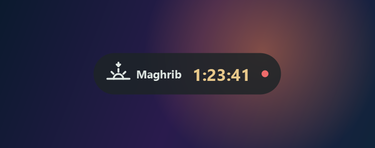
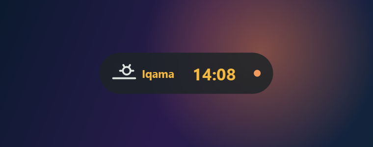
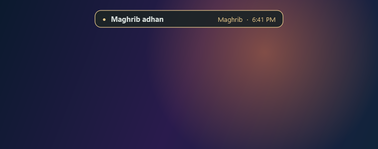
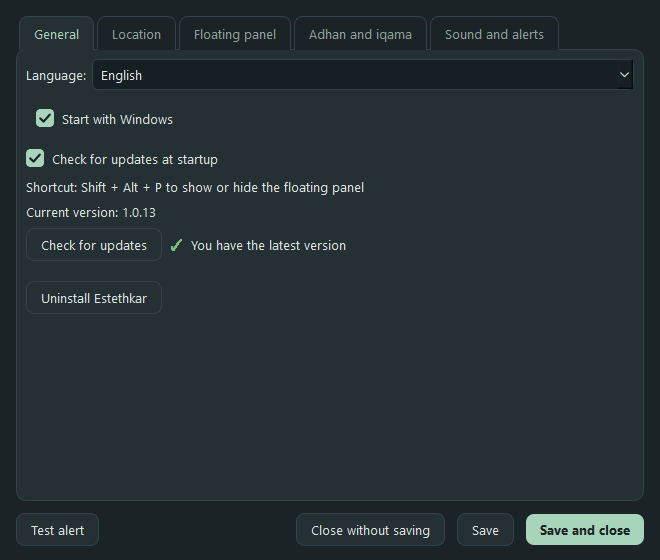
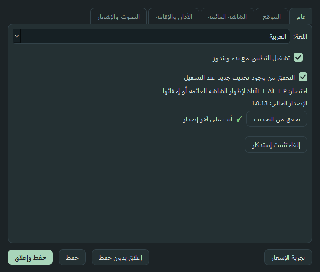

# Estethkar

**A small floating countdown for Windows that stays above your games and alerts you at adhan and iqama.**

**English** | [العربية](README.ar.md)

 

## Download

**[Download the installer: Estethkar-Setup.exe](https://github.com/NuClear-Mind/Estethkar/releases/latest/download/Estethkar-Setup.exe)**

- One file. It asks for a folder, adds a desktop shortcut and starts the app.
- No installer? Download `Estethkar.exe` from the [releases page](https://github.com/NuClear-Mind/Estethkar/releases/latest) and run it.
- Requires Windows 10 or 11.

## Features

- **Counter over your games.** A horizontal or vertical capsule, or a full panel. Size from 50% to 250%, movable with the mouse. `Shift + Alt + P` shows or hides it.
- **Iqama stands out.** The iqama countdown is gold and labelled, so it is never mistaken for the adhan.
- **Quiet heads-up.** The dot blinks 3 seconds before adhan and 5 seconds before iqama, silently.
- **Alert and sound, always.** A banner at the top or a card in a corner, with four built-in sounds or your own WAV file. They work while a game is running.
- **Accurate times, offline.** Calculated on your PC for your city (Umm al-Qura). You can shift each prayer by seconds to match your mosque.
- **Arabic and English,** with cities searchable in both.
- **Starts with Windows,** updates itself from inside the app with one click, and uninstalls completely from the settings.

  

   

## Games

- The panel and alerts show above games in **Borderless** or **Windowed Fullscreen** mode.
- True **Exclusive Fullscreen** hides every window above it. This is a Windows limit: the sound still plays, but nothing shows. Switch the game to Borderless.
- The app **never touches the game**: no injection, no memory reading, no hooks. It uses a normal window and standard Windows calls only. Still, I cannot promise how every anti-cheat treats an overlay window, so be careful in strict competitive games.

## Privacy

- No account, no tracking, no ads. Nothing about you is sent anywhere.
- Settings are stored in a `config.json` next to the app, on your PC only.
- The only network connections are:
  1. Checking GitHub for updates (can be turned off in Settings).
  2. Detecting your city from your IP through `ipapi.co`, only if you choose "automatic". The default is picking the city yourself.

## Windows warning

The app is new and not code-signed, so Windows **SmartScreen** may warn, or an antivirus may flag it by mistake. This happens with small unsigned apps.

- Click **More info**, then **Run anyway**.
- You can verify the file. The **SHA-256** of each file is in the release notes. In PowerShell: `Get-FileHash .\Estethkar-Setup.exe`

## About the times

- Method: **Umm al-Qura** (Fajr 18.5°, Isha 90 minutes after Maghrib and 120 in Ramadan). Results were compared against the Aladhan service.
- Times depend on the Windows clock and time zone, so keep time sync on.
- Your mosque's or city's official timetable is the authority. Use the per-prayer adjustment in Settings if it differs.

## Uninstall

Settings → General → **Uninstall Estethkar**, or Windows Settings → Apps. It removes the app, its files, the shortcut and the start-with-Windows entry.

## Problems and ideas

Open an [issue](https://github.com/NuClear-Mind/Estethkar/issues/new/choose) with the version, the game and its display mode.

Changelog: [CHANGELOG.md](CHANGELOG.md)

## License and credits

MIT. Copyright (c) 2026 Turky ALrowaily. See [LICENSE](LICENSE).

City data comes from [GeoNames](https://www.geonames.org/) (cities with 15,000 people or more), licensed under [CC BY 4.0](https://creativecommons.org/licenses/by/4.0/).
